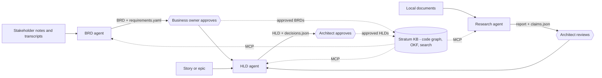
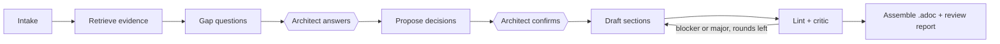
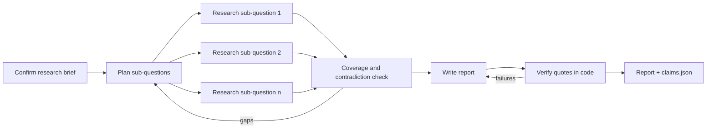
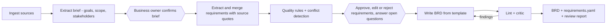

# Architecture Agents Suite: Strategy and Agent Designs

| | |
|---|---|
| **Owner** | Kapil |
| **Status** | Draft v0.1 |
| **Date** | 23 Nov 2026 |
| **Repo** | [kkhurana82/Agents](https://github.com/kkhurana82/Agents) |
| **Agents covered** | HLD agent (v0.1 built), Research agent (design), BRD agent (design) |

Confidence tags: **[Certain]** established fact or verified · **[Likely]** strong inference · **[Guessing]** important information missing.

---

## 1. Summary

- **Objective.** Shorten the path from a business need to an approved design without lowering design quality. AI drafts and checks; people decide.
- **Three agents, one chain.** The BRD agent turns stakeholder input into an approved Business Requirements Document. The Research agent answers open questions from documents. The HLD agent turns approved requirements and research into a High-Level Design.
- **Artifacts are the interfaces.** Each agent produces a human document plus a machine-readable sidecar (`requirements.yaml`, `claims.json`, `decisions.json`). The next agent reads the sidecar. A person approves at every handoff. There is no "super-agent" orchestrating everything.
- **Grounding is checked in code, not hoped for.** Every claim cites evidence with a stable ID. Code checks that the citation exists, and for research, that the quoted text is really in the source.
- **Stratum is the knowledge layer.** Agents read code, OKF concepts, standards and approved artifacts through MCP. Approved outputs flow back into Stratum, so each design makes the next one better.
- **Adopt before building.** Use open-source research agents as baselines. Build only where a measured gap exists.

---

## 2. Strategy

### 2.1 Problem

- Writing a BRD or HLD means hunting for context across code, old designs, standards and people. Most of that time is spent finding things, not deciding things.
- Quality depends on who writes the document. Templates are followed unevenly, and non-functional requirements and failure handling are the usual gaps.
- Traceability from business need → requirement → design decision is rarely maintained.
- Generic AI assistants produce plausible text that may invent systems, interfaces or numbers. Design documents cannot tolerate that.

### 2.2 The suite at a glance

| Agent | Input | Output | Human checkpoints | Status |
|---|---|---|---|---|
| **BRD agent** | Stakeholder notes, meeting transcripts, emails, existing docs, epics | BRD (`.adoc`) + `requirements.yaml` | Confirm brief; approve requirement list | Design |
| **Research agent** | A research question + local documents (later: Stratum) | Report (`.md`/`.adoc`) + `claims.json` | Confirm research brief | Design |
| **HLD agent** | Approved requirements, research findings, Stratum/KB evidence, HLD template | HLD (`.adoc`) + review report | Answer gap questions; confirm design decisions | **v0.1 built** |

### 2.3 How they connect



The handoff contracts are what make the chain work:

| From → To | Contract | Why it matters |
|---|---|---|
| BRD → HLD | `requirements.yaml`: BR/FR/NFR/CON IDs, measurable targets, acceptance criteria, source references | The HLD agent skips re-extracting requirements. IDs stay stable from business need to design decision. |
| Research → HLD | `claims.json`: claims with verbatim quotes and passage IDs | Research findings become citable evidence for design decisions. |
| HLD → Stratum | Approved `.adoc` + `decisions.json`, tagged with template section IDs | Future HLDs can find past decisions and sections by type. |

### 2.4 Design principles

1. **People decide; agents draft and check.** Every agent pauses where a wrong call is expensive: scope, requirements, design decisions.
2. **Decide before writing.** Agents confirm the few things that shape the document (brief, requirement list, design decisions) before writing pages. Correcting six decisions is cheaper than correcting twenty pages.
3. **Evidence or assumption, nothing in between.** A statement about the existing world either cites evidence (`<<EV-n>>`) or is labelled as an assumption or open issue.
4. **Deterministic first.** Structure, citations, coverage, quote matching and formatting are checked in code. The LLM critic handles judgement only.
5. **Templates are data.** Document structure comes from the team's `.adoc` templates, or is learned from approved documents. A template change needs no code change.
6. **Artifacts are the interfaces.** Agents are independent, testable programs connected by documents and sidecars, not by a shared prompt or a supervisor agent. **[Likely]** This keeps each agent replaceable and auditable.
7. **Measure against a gold set.** No agent ships without a set of real cases it is scored on.

### 2.5 Shared platform (`common/`)

Two agents already need the same building blocks; the third will too. Extract them now, and keep the package small.

| Component | Used by | Source |
|---|---|---|
| LLM seam (structured output, per-task models) | All | From hld-agent `llm.py` |
| Evidence pool (stable IDs, de-duplication) | All | From hld-agent `retrieval/base.py` |
| Citation check + **quote verification** | All | Citation check exists; quote verification new |
| MCP retrieval provider (stdio / HTTP, result mapping) | All | From hld-agent `mcp_provider.py` |
| AsciiDoc template parser + normaliser + lint base | HLD, BRD | From hld-agent `template.py`, `adoc.py` |
| Checkpointed human pauses (LangGraph interrupts + file resume CLI) | All | From hld-agent `cli.py` |
| Eval harness (gold sets, scoring, reports) | All | New |

A shared document service, **`docs-mcp`**, is the second platform piece. It reads PDFs/Word/AsciiDoc/Markdown with structure (headings, tables, page numbers), indexes passages (BM25 + vectors) with stable IDs (`doc#page#chunk`), and exposes `search`, `read_passage`, `list_docs` and `verify_quote` over MCP. The Research agent, the BRD agent and the HLD agent's "learn from approved HLDs" feature all use it.

### 2.6 Build vs adopt

| Need | Adopt | Build | Decision |
|---|---|---|---|
| Deep research loop | GPT Researcher (local docs via `DOC_PATH`), LangChain open_deep_research (LangGraph, MCP) | Quote verification, coverage, contradictions | Baseline first, then build only the measured gaps **[Likely]** |
| Knowledge layer | Stratum (in progress), Knowledge Catalog for OKF concepts | Not in this repo | Consume over MCP |
| Requirement quality rules | ISO/IEC/IEEE 29148 characteristics, EARS sentence patterns | Rule implementation + traceability | Build on the standards; small, deterministic |
| Orchestration | LangGraph | Not needed beyond it | Use |
| Document rendering | Asciidoctor (+ asciidoctor-diagram / Kroki) | None | Use |

### 2.7 Role of Stratum and OKF

- **Stratum stays the single retrieval contract.** Agents call Stratum's MCP tools for code, interfaces, data stores and graph neighbours. Knowledge Catalog (OKF concepts) can be a second MCP provider for curated concepts. **[Likely]** Catalog search does not follow links between OKF pages, so relationships still come from Stratum's graph.
- **Use OKF trust signals.** Skip deprecated concepts, prefer human-verified ones, and flag any decision that rests only on unverified or stale concepts.
- **Templates stay in Git, not in Stratum.** Agents need the full structure every time, not top-k search results. Stratum stores approved documents, tagged by template section, with a link to the template version used.
- **Close the loop.** Approved BRDs and HLDs are ingested back into Stratum as human-reviewed OKF concepts, with decisions as separate concepts so they can be reused as precedent.

### 2.8 Roadmap

Effort assumes part-time work alongside the day job. **[Guessing]**

| Phase | Scope | Exit criteria |
|---|---|---|
| **0. Gold sets** (week 1) | 10–15 cases per agent: synthetic copies in the repo, real ones inside Sabre only. Run GPT Researcher on local docs as a baseline. | Each agent has a scored baseline. |
| **1. HLD v0.2 + common** (weeks 1–2) | Prompts moved to files, template version recorded in output, `common/` extracted, `requirements.yaml` intake | hld-agent tests green on `common/`; HLD run on 3 approved past features |
| **2. docs-mcp** (weeks 2–3) | Document reader, passage index, MCP server, `verify_quote` | Right passage in the top 5 results for ≥80% of gold questions |
| **3. BRD agent v0.1** (weeks 3–5) | Full flow with quality rules and traceability | End-to-end demo: notes → approved BRD → HLD draft, IDs traced throughout |
| **4. Research agent v0.1** (weeks 5–7) | Built only if the baseline misses on citations, coverage or contradictions | Beats baseline on quote verification and coverage |
| **5. Learning + reach** (week 8+) | `hld-agent learn` (template + examples from approved HLDs), on-demand OKF lookups with trust handling, agents exposed as MCP servers for chat use | Architects use it from chat; template learned from ≥10 approved HLDs |

**Why the BRD agent before the Research agent [Likely]:** the BRD agent has a clear output and completes the chain into the HLD agent, giving an end-to-end demo. The Research agent's purpose still needs its question set; Phase 0 covers that cheaply in parallel.

### 2.9 Evaluation

| Agent | Primary metrics | Guardrail metric |
|---|---|---|
| HLD | Decision agreement with the approved HLD; requirement coverage; architect edit time to approval | Invented components or interfaces = **0** |
| Research | Passage recall@5; quote verification pass rate; coverage of sub-questions; contradictions found vs gold | Claims without a verified quote = **0** |
| BRD | Requirement recall vs analyst-written BRD; precision of ambiguity flags; % requirements traced to a source | Requirements with no source = **0** |

Every run writes a review report (status, coverage, open findings). Track these per release, not per anecdote.

### 2.10 Risks

| Risk | Mitigation |
|---|---|
| Plausible but wrong content | Evidence IDs, citation and quote checks in code, human gates, review report |
| No access to official templates | Learn templates from approved documents; architect approves the learned template |
| Knowledge goes stale | Commit SHAs on evidence; OKF freshness fields; prefer recent approved docs |
| "General-purpose" scope creep | Gold sets define each agent's scope; out-of-scope requests fail visibly |
| Low adoption (drafts ignored) | Measure edit time; start with one team; expose the agents in the chat tools people already use (MCP) |
| Cost and latency | Per-task models (cheaper critic), cached retrieval, only failing sections redrafted |
| Data policy | See 2.11 |

### 2.11 Governance and data handling

- The public repo contains **generic code and synthetic examples only**: no Sabre code, documents, templates or data.
- Running against real Sabre material happens **only inside an approved Sabre environment**, with an approved model provider (for example Vertex AI in a Sabre GCP project). **[Guessing]** Confirm the approved setup with security before the first real run.
- Every output is labelled as an AI-assisted draft. Decisions are recorded with their approver. Checkpoint databases act as the audit trail.

---

## 3. HLD agent

**Purpose.** Draft a High-Level Design in AsciiDoc that follows the team's template and is grounded in evidence, with the architect confirming decisions before any section is written.

**Status.** v0.1 is in the repo (`hld-agent/`): 12 tests passing, a real MCP round-trip tested against a stub Stratum server, and output rendered by Asciidoctor with warnings treated as failures.

### 3.1 Flow



### 3.2 Key design choices

| Choice | Detail |
|---|---|
| Template-driven | Parses the `.adoc` template: each `==` section is a drafting unit, deeper headings are the required outline, body text and comments are guidance. Optional `// hld:` hints set diagrams, citation minimums and roles. |
| Decisions first | 3–8 decisions, each with options, choice, rationale and evidence. Accept / amend / reject at a checkpoint. Lint flags references to rejected decisions. |
| Grounding enforced | Citations must resolve to retrieved evidence. Sections describing existing systems must cite something. The evidence appendix lists URI and commit. |
| Targeted revision | Only sections with blocker/major findings are redrafted, with a cap on rounds; anything left goes in the review report. |
| Offline testable | A scripted model runs the full graph in CI, with deliberate faults injected (invented citation, Markdown slip). |

### 3.3 Checks

| Rule | Checks |
|---|---|
| L001–L002 | Empty sections, placeholder text (TBD, TODO) |
| L003–L004 | Citations that don't exist; too few citations |
| L005, L008–L010 | Markdown in AsciiDoc; unterminated blocks; heading levels; invalid diagram blocks |
| L006–L007 | Missing template sub-headings; missing required diagrams |
| L101–L105 | Requirements not traced; NFRs not addressed; decisions unreferenced; unknown IDs |

### 3.4 Roadmap (v0.2 → v0.3)

- Move prompts into versioned files so architects can tune them without Python.
- Record the template version (path@commit) in the output header and review report.
- Read `requirements.yaml` from the BRD agent; skip LLM extraction when it is present.
- `hld-agent learn --hld-repo <path>`: learn the template (section frequency, order, diagram habits, guidance) and an example index from approved HLDs. An architect reviews and commits the learned template.
- On-demand lookups during drafting (at most 3 per section), using OKF trust and freshness. Everything looked up joins the evidence pool, so the citation checks still apply.
- Expose as an MCP server (`start_hld`, `answer_questions`, `confirm_decisions`, `get_draft`) for use from chat.

### 3.5 Open questions

- Which diagram syntax does the Sabre AsciiDoc pipeline render: Mermaid or PlantUML?
- What is Stratum's real search tool contract (name, arguments, result shape)?
- How many approved HLDs are available for learning (≥10 needed for reliable statistics **[Guessing]**)?

---

## 4. Research agent

**Purpose.** Answer research questions that need synthesis across many documents: comparisons, disagreements, coverage. Not simple lookups.

**Status.** Design. Baseline-first.

### 4.1 Step 0: define it by its questions

Write 10–15 real questions, each with the documents that should answer it.
- If most are lookups, plain document search via `docs-mcp` is enough and no agent is needed.
- The agent earns its keep on synthesis questions: "How do these 30 documents differ on X, and where do they disagree?"

### 4.2 Baseline

Run **GPT Researcher** in local-documents mode on the same questions. Score it for:
- citation granularity (whole document vs page or passage);
- claims not supported by the cited text;
- relevant documents never read;
- disagreements smoothed over.

**[Guessing]** These are the likely gaps. Build only the ones the scores confirm.

### 4.3 Flow (if built)



| Step | Detail |
|---|---|
| Brief | Agent restates question, scope and document set; the user approves. |
| Sub-question research | Search → read passages → record claims, each with a **verbatim quote** and passage ID. Runs in parallel. |
| Coverage | Lists sub-questions without evidence, documents never opened, and claims that contradict each other. One extra research round for gaps. |
| Report | Findings, inline citations, a contradictions table, and limits of the evidence. |
| Quote verification | Each quote must appear in the cited passage (normalised whitespace). A failed claim is rewritten or removed. This is the single strongest defence against invented citations. **[Likely]** |

### 4.4 Reuse

LLM seam, evidence pool, citation check, checkpoint CLI and critic loop from `common/`; retrieval from `docs-mcp`. Borrow open_deep_research's LangGraph structure for parallel sub-research rather than inventing a new one.

### 4.5 Open questions

- Which document sets come first, and who writes the question set?
- Does the report need AsciiDoc to match other Sabre docs, or is Markdown fine?

---

## 5. BRD agent

**Purpose.** Turn messy stakeholder input into a structured, testable, traceable Business Requirements Document, and hand clean requirements to the HLD agent.

**Status.** Design.

### 5.1 Is AI justified here?

Partly. **[Likely]**
- **AI is useful for** extracting requirements, goals, scope and stakeholders from transcripts and notes, merging duplicates, and spotting conflicts between stakeholders.
- **Code is better for** requirement quality rules, ID management, traceability and template structure. These must be consistent, so they are deterministic.

Closest existing approaches: requirement quality checkers built on INCOSE/EARS rules inside requirements tools (e.g. Jama Connect Advisor), and generic AI assistants in Jira/Confluence. **[Likely]** The gap this agent fills: requirements extracted from raw stakeholder input with every requirement traced to a verified source quote, and a machine-readable handoff into design.

### 5.2 Inputs and outputs

| Inputs | Outputs |
|---|---|
| Meeting transcripts and notes, emails, existing product docs, epics/features (via `docs-mcp`; later Rally over MCP) | BRD (`.adoc`, from the BRD template or one learned from approved BRDs) |
| BRD template | `requirements.yaml` (handoff to the HLD agent) |
| Stratum, for existing capabilities and terminology | Review report: quality findings, conflicts, open questions |

Typical BRD sections: purpose and background, business objectives and success metrics, stakeholders, scope (in/out), business requirements (BR-n), functional requirements (FR-n) with acceptance criteria, non-functional requirements (NFR-n) with measurable targets, constraints (CON-n), assumptions, dependencies, open questions.

### 5.3 Flow



### 5.4 Requirement quality rules (deterministic)

Based on ISO/IEC/IEEE 29148 quality characteristics (necessary, unambiguous, singular, verifiable, feasible, traceable). **[Certain]** for the standard; rule thresholds need tuning on the gold set.

| Rule | Flags | Example |
|---|---|---|
| R1 Ambiguous wording | Vague terms with no measure | "fast", "user-friendly", "flexible", "as appropriate", "etc.", "and/or" |
| R2 Not singular | Two behaviours in one requirement | "shall validate the PNR and send a notification" |
| R3 Not verifiable | Functional requirement without acceptance criteria | FR with no Given/When/Then or equivalent |
| R4 Unmeasured NFR | NFR without a target | "highly available" with no percentage |
| R5 No source | Requirement not traced to a stakeholder statement | Missing or unverified source quote |
| R6 Duplicate | Near-identical requirements (text similarity) | Two phrasings of the same need |
| R7 Solution, not requirement | Requirement prescribes a technology | "use Kafka" → move to constraints or leave for the HLD |
| R8 Placeholder | TBD / TODO in requirement text | "Volume: TBD" |
| R9 Conflict (LLM, human-confirmed) | Requirements that cannot both hold | Two stakeholders with contradictory rules |

Optional rewrite suggestions follow **EARS** sentence patterns, e.g. "When <trigger>, the <system> shall <response>."

### 5.5 Traceability

- Every requirement carries `sources: [{doc, passage, quote}]`. The quote is verified in code against the passage, the same mechanism as the Research agent.
- IDs are assigned once and kept stable across revisions. `requirements.yaml` carries them into the HLD agent, and the HLD's traceability appendix links them to sections and decisions.

### 5.6 Handoff contract (`requirements.yaml`, sketch)

```yaml
brd: seat-concierge
version: 1
approved_by: <business owner>
requirements:
  - id: FR-3
    kind: functional
    text: Assign the chosen seat through the existing seat assignment path.
    acceptance:
      - Given a valid candidate seat, when the passenger confirms, then the seat is assigned via the seat assignment service.
    sources:
      - {doc: workshop-2026-11-12.md, passage: "p2#c4", quote: "it has to go through the normal seat assignment"}
  - id: NFR-1
    kind: non_functional
    category: performance
    text: Candidate seats returned quickly.
    target: p95 <= 1.5 s
```

### 5.7 Open questions

- Is there a Sabre BRD template, or should it be learned from approved BRDs?
- Who approves a BRD: product owner, business analyst, or both?
- Are meeting transcripts available in text form, and may they be processed in the approved environment?

---

## 6. Repository layout (target)

```
Agents/
├── common/            # LLM seam, evidence pool, citation + quote checks, MCP providers, template parser, eval harness
├── docs-mcp/          # document reader + passage index + MCP server (search, read_passage, list_docs, verify_quote)
├── hld-agent/         # v0.1 in repo
├── research-agent/
├── brd-agent/
├── evals/             # synthetic gold sets (real ones stay inside Sabre)
└── docs/
    └── strategy.md    # this document
```

---

## 7. Next actions

1. Write the gold sets: 10–15 cases each for HLD, Research and BRD (synthetic in repo, real inside Sabre).
2. Run GPT Researcher on local documents as the research baseline and score it.
3. HLD v0.2: prompts to files, template version in output, `common/` extracted, `requirements.yaml` intake.
4. Build `docs-mcp` and measure passage recall before writing agent logic.
5. BRD agent v0.1, then the end-to-end demo: notes → BRD → HLD with IDs traced throughout.
6. Confirm the approved environment and model provider for running on real Sabre material.

---

## Glossary

| Term | Meaning |
|---|---|
| BRD | Business Requirements Document: what the business needs and why |
| HLD | High-Level Design: how the system will meet the requirements, at component level |
| Evidence ID (`EV-n`) | Stable reference to a retrieved source passage, cited in documents as `<<EV-n>>` |
| Sidecar | Machine-readable file produced next to a document for the next agent |
| MCP | Model Context Protocol: standard way for agents to call tools and data sources |
| OKF | Open Knowledge Format: Markdown + YAML concept pages with provenance, verification and freshness fields |
| EARS | Easy Approach to Requirements Syntax: sentence patterns for clear requirements |
| Gold set | Real cases with known good answers, used to score an agent |
